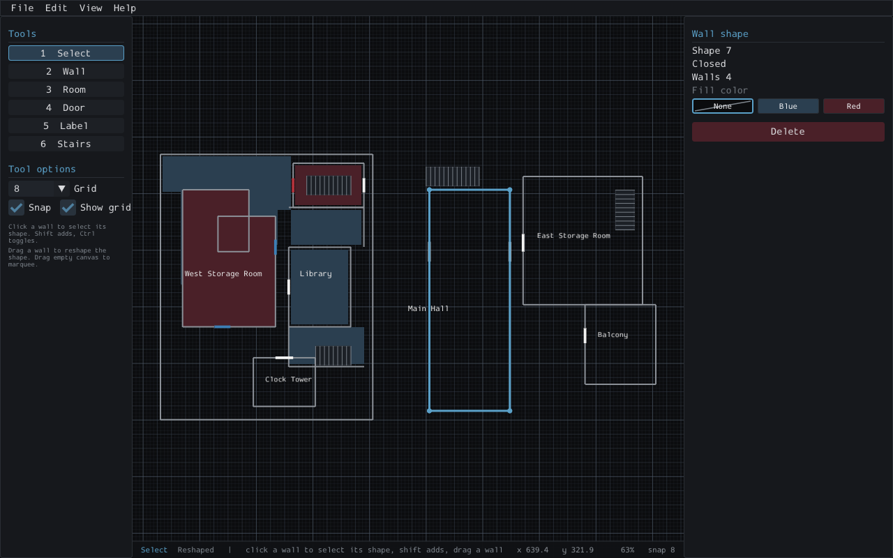

# Ink Ribbon Level Editor

A native 2D level editor for floor-plan style maps. It is written in C with sokol and Dear ImGui and it targets the look of the RE2 library reference map: near-black canvas, thin orthogonal walls, dark blue and red painted areas, white, red, and blue doors fixed to walls, room labels, and hatched stairs.


The demo level in `levels/re2-library.lvl` is loaded on startup. It has 42 walls, 6 painted areas, 10 doors, 6 labels, and 4 stair runs. `tools/gen_demo_map.py` regenerates it from readable coordinates.

## Build and run

The project is tested on Linux with X11 and OpenGL. It needs a C and C++ compiler, make, pkg-config, and the X11, Xi, Xcursor, and GL development packages.

Fedora:

```sh
sudo dnf install gcc gcc-c++ make pkgconf-pkg-config libX11-devel libXi-devel libXcursor-devel mesa-libGL-devel
```

Debian and Ubuntu:

```sh
sudo apt install gcc g++ make pkg-config libx11-dev libxi-dev libxcursor-dev libgl1-mesa-dev
```

`make verify` also needs `xdotool`, ImageMagick (for `import`, `convert`, and `compare`), and `Xvfb`. The editor itself does not use them. Verification runs on a private Xvfb display, so it never moves your mouse or touches your desktop. The harness tags every process with a per-run id, such as `ink-ribbon-editor-4192-7731`, claims its own X display with a lock, and records itself in `/tmp/ink-ribbon-runs`. Two runs can therefore go at once on separate displays. Each run kills only its own processes on exit or SIGTERM, and the next run reaps the processes and display lock of any run that was killed outright. `make verify` also fails if its own run leaves anything behind.

Build and run from the repository root:

```sh
git submodule update --init --recursive
make
./build/editor
```

Load another level with `./build/editor --level path/to/level.lvl`. The `levels/` path is relative to the working directory.

`sokol` is pinned at `93aa187b5d387cc24b7290b3ca3f13f61e139e7c` and `dcimgui` (Dear ImGui 1.93.0 C bindings) at `2c0e382fc10771bbd5dac15fc34f7fab84f87917`. Both live in `vendor/` as git submodules.

## What you can do

- Draw walls click by click. Every segment is horizontal or vertical and continues from the last click.
- Close a drawn loop by clicking its first point or pressing Enter. Close with an L-shaped pair when the last point is not aligned with the first. Press Esc to keep the chain open.
- Each drawn chain is one wall shape. Select any of its lines to select the shape, then drag a line to reshape it: that line moves and the lines connected to it stretch, while opposite lines stay put.
- A closed shape fills only its own inside, in blue or red, or not at all with the None fill. Draw a painted area independently with the Room tool when it should not follow walls.
- Add white, red, or blue doors to walls. A door keeps a fixed thickness, slides along its wall, and changes length by dragging either end or with the inspector.
- Add text labels anywhere, edit the text in the inspector, resize and move them.
- Add standard stairs with 2 to 48 steps. The step count sets the run length, and each run is horizontal or vertical.
- Select, edit, and delete the placed objects. Deleting a shape removes its walls and the doors hosted by them.
- Click to select, shift-click to add, Ctrl-click to remove, or drag from empty canvas to marquee select. Delete removes the whole selection in one step. Dragging a wall line reshapes its shape, and dragging labels, rooms, or stairs moves them together.
- Snap to the grid on placement, dragging, and reshaping. The drawn grid follows the selected Grid size, so every line is a position objects can land on. The grid sizes are 4, 8, 16, and 32 world units, and the Snap checkbox turns snapping off.
- Pan, zoom, fit the level, undo and redo, save, and load.

## Controls

| Input | Action |
| --- | --- |
| 1 to 6 | Select, Wall, Room, Door, Label, Stairs |
| Left click | Use the active tool |
| Shift plus left click | Add an object to the selection |
| Ctrl plus left click | Toggle an object in the selection |
| Drag a wall line | Reshape the shape by sliding that line and stretching its neighbours |
| Drag on empty canvas | Marquee select; Shift adds to the selection |
| Middle drag, or Space plus left drag | Pan |
| Mouse wheel | Zoom around the cursor |
| Enter | Close a wall chain or room polygon |
| Esc | Clear the selection, cancel a draft, or cancel a drag |
| Backspace | Remove the last wall in the current chain |
| Delete | Delete every selected object |
| F | Fit the level |
| G | Toggle the grid |
| Ctrl+Z, Ctrl+Y, Ctrl+Shift+Z | Undo, redo |
| Ctrl+S, Ctrl+Shift+S | Save, save as |
| Ctrl+O | Open |
| H | Controls dialog |

## Editing model

Walls are independent axis-aligned segments. Corners meet because the wall tool starts each new segment at the previous click. A wall has a stable id. Doors store that id, a normalized center position, and a world-space length, so a door follows its wall and never points at a deleted one.

Painted areas are explicit polygons. That keeps their color and identity when nearby walls change, and it allows fills that are not exact wall loops, as in the reference. Painted areas do not follow wall edits.

Labels store a position, a size, and a string. Stairs store a center, a direction, and a step count. `STAIR_STEP_DEPTH` and `STAIR_WIDTH` fix the tread size.

Selection is UI state and is never saved into a level. It is a bounded set per object kind plus a primary object. Shift-click adds an object, Ctrl-click toggles it, a marquee replaces or adds to the set, and Delete removes every selected object with one undo step. Dragging a wall line reshapes its shape. Selected rooms, labels, and stairs move as a group when dragged. A door stores its host wall id and a normalized position, so a door travels with its wall and cannot leave it. A door dragged alone still slides along its wall, and a door end still resizes it.

Snap-to-grid applies to wall and room points, labels, stairs, door centers, door resize spans, reshapes, and object drags. A group drag snaps from the primary object, so the relative spacing of the group stays intact. Snap is on by default. The grid sizes are 4, 8, 16, and 32 world units.

Undo stores whole level snapshots. Each completed change writes one snapshot. A wall click, a drag, and a property edit each undo as their own step. Closing a loop writes its closing walls and the fill together. The history keeps 64 levels.

## Selection, shapes, and snapping


A plain click on an unselected object selects only it. Clicking an object already in a multi-selection keeps the group and makes it primary. Shift-click adds an object and never removes one. Ctrl-click toggles it. Dragging from empty canvas draws a marquee, and Shift makes the marquee additive. The inspector shows per-kind counts for a multi-selection, and Delete removes the whole set in one undo step.

A wall belongs to a shape, and each line is selectable on its own. Click a line to select that edge, shift-click to add another, or click inside a closed shape to select all of its edges. The inspector then shows the shape: its fill, whether it is closed, how many walls it has, and which edge you are on.


Drag a selected line to reshape it. The line slides along its normal, snapped to the grid, and every line that meets it stretches. Lines on the opposite side stay where they are. Select several lines and they slide together, so two opposite walls can move at once and a shared corner follows both axes.

Dragging while a whole shape, or a mixed marquee selection, is active moves everything rigidly instead. Walls translate, their doors follow by wall id, and rooms, labels, and stairs move with them.



Selected edges draw in the accent colour, the rest of their shape draws dimmed, and the endpoints of selected edges turn amber so the vertices you are about to move are obvious. Doors ride their host wall through a reshape. A door dragged alone slides along its wall, and dragging an end handle resizes it.

## Focus and the pointer

ImGui reports the pointer position as a sentinel when the window has none, which is what happens when you alt+tab away. The editor treats that as "no pointer": it draws no preview, ends any drag at its last applied position, and leaves an open wall chain alone. When focus returns and you move the mouse, the chain preview comes back and drawing continues.

Before this was handled, leaving the window mid-chain made the preview build a dashed line of astronomically large length, which pinned a core and grew memory until the machine froze. `make verify` now covers that case.

## Project layout

| Path | Owns |
| --- | --- |
| `src/main.c` | sokol app lifecycle, font, frame order |
| `src/editor.c` | ImGui theme, panels, canvas, gestures, camera, modals |
| `src/level.c` | level document, shapes, edits, save, load, undo ring |
| `src/geom.c` | vectors, snapping, segment and polygon math, triangulation |
| `tests/test_level.c` | 294 headless checks for the core |
| `tools/verify.sh` | end-to-end X11 check with pixel and coordinate evidence |
| `tools/shot.sh` | build, launch, drive, screenshot |
| `tools/xvfb.sh` | private X display, per-run process tags, cleanup |
| `tools/focus_drop.py` | drop X focus the way alt+tab does |
| `tools/gen_demo_map.py` | regenerate the demo level |
| `tools/level_info.c` | print counts, shapes, and bounds for a level file |

Only `main.c` and `editor.c` include sokol or ImGui headers. `make test` links the core with gcc alone, so a core file that pulls in a UI header fails the build.

## Verification

```sh
make test
make verify
```

`make verify` runs `tools/verify.sh`, which rebuilds, runs the core tests, drives the real X11 window with xdotool, samples canvas pixels, and compares saved levels coordinate by coordinate. A recorded run at 1280x800:

```text
PASS build without warnings
PASS core tests (294 checks)
PASS demo fills blue=28695 red=26004
PASS closed chain is one shape with a blue fill
PASS None and Blue fill controls work
PASS plus fill is inside only (inside=2B3F50 corner=0B0C0E)
PASS dragged line moved, neighbours stretched, opposite line stayed
PASS group drag moved every wall by (112,0) with no reshape and every door followed
PASS two edges selected (accent px=1508, amber px=104) and both moved on drag
PASS grid size 8 draws 13046 px and 32 draws 2760
PASS focus loss survived (rss=105880 KB, 15970 px changed)
PASS no leftover editor or display processes
ALL EDITOR CHECKS PASSED
```

The script assumes a 1280x800 window and the default panel widths, and it uses its own Xvfb display. Screenshots land in `/tmp/ink-ribbon-verify-*.png`.

## Limits

- Walls are horizontal or vertical only, and an edge slides only along its normal, so a wall cannot be dragged diagonally or turned into a diagonal. Deleting an edge cascades its doors and reopens the shape if the loop breaks.
- Painted areas are independent polygons and do not follow wall edits.
- Fixed capacities are 512 shapes, 512 walls, 64 painted areas, 256 doors, 128 labels, and 64 stair runs. A capacity failure is reported in the status strip.
- One level is open at a time. New and Open do not ask before discarding unsaved changes. There is no copy and paste and no native file dialog.
- Group drag moves walls, rooms, labels, and stairs. Doors follow their host walls, so a selected door whose wall is not selected stays put. A single selected door slides along its wall instead.
- The editor was tested on Linux and X11 only.

## Third party

- [sokol](https://github.com/floooh/sokol), zlib/libpng license.
- [dcimgui](https://github.com/floooh/dcimgui), Dear ImGui under the MIT license.
